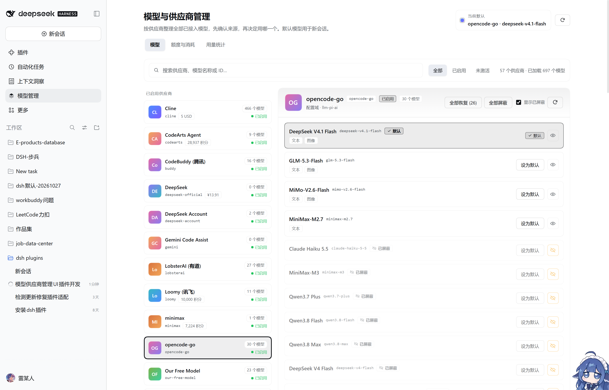
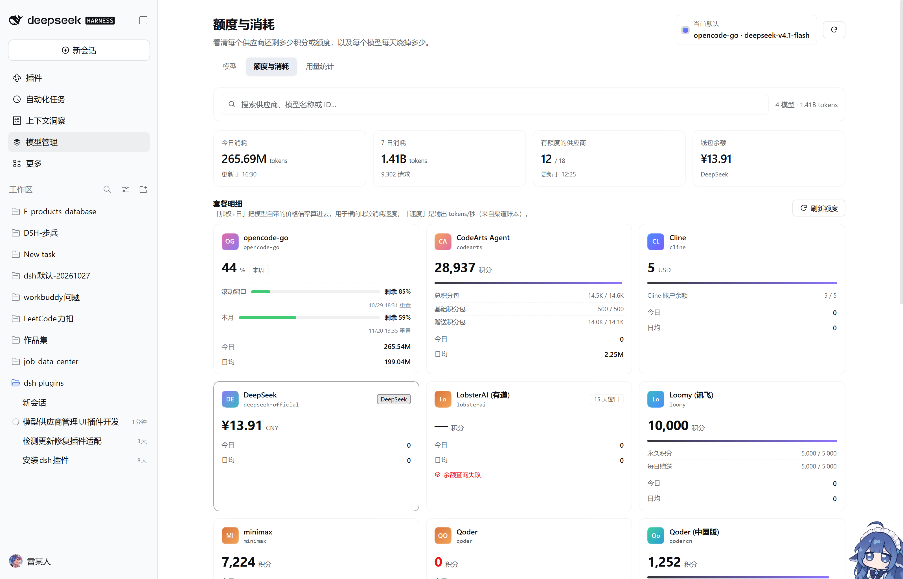
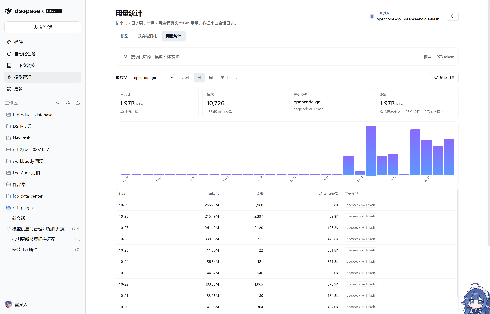

# Model Manager · 模型与供应商管理

[](https://github.com/Rexray117/dsh-model-manager)
[](https://github.com/Rexray117/dsh-model-manager/actions/workflows/ci.yml)
[](https://github.com/Rexray117/dsh-model-manager/releases)
[](./LICENSE)
[]()

> 一个 **DeepSeek Harness（DSH）桌面端插件**：把散落在各处的模型与供应商收拢成一页可管理、可量化、可屏蔽的控制台。

| 模型管理 | 额度与消耗 | 用量统计 |
| --- | --- | --- |
|  |  |  |

接入多个 API 与模型插件后，对话框里的模型下拉框会把所有供应商的模型混在一起，容易选错。本插件提供一个独立页面：**按供应商看清来源、屏蔽多余模型、挑选默认模型**，并跟踪**剩余额度**、**订阅计划额度**与**按小时 / 日 / 周 / 半月 / 月的真实用量**。

## 功能

### 模型管理

- **侧栏入口**：左侧导航新增「模型管理」图标，打开全页的管理界面（不遮挡、不覆盖 Harness 原生界面）。
- **供应商分组**：自动区分「已启用」（已注册适配器）与「可配置 · 未激活」两组；未激活的供应商说明它还缺凭据或配置。
- **来源可见**：每个供应商显示名称、机器 ID、状态、剩余额度标签、模型数量、配置域（settingsNs）、默认接入地址。同名模型的归属一目了然。
- **模型清单**：逐个供应商列出全部模型，包含 ID、描述与输入模态（文本 / 图像）标签，并标出当前默认项。
- **屏蔽 / 恢复模型**：每行右侧的眼睛按钮切换该模型是否出现在对话框的模型菜单；表头另有「全部恢复」「全部屏蔽（二次确认）」「显示已屏蔽」开关，隐藏行会灰显并标注「已屏蔽」。屏蔽数量实时显示在按钮上。
- **WorkBuddy 双版本管理**：`workbuddy` 路由同时承载**国际版**（www.workbuddy.ai 的 gpt / gemini / claude / grok 系）与**国内版**（腾讯 CodeBuddy 的 glm / hy / kimi / minimax / deepseek 系）模型。每个模型带「国际版 / 国内版 / 共用」标签，详情页顶部按版本分组显示数量并各带「屏蔽 / 恢复」按钮，另有「全部版本 / 国际版 / 国内版」筛选，可整组退出模型菜单。
- **搜索与筛选**：按供应商名、供应商 ID、模型名、模型 ID、描述实时过滤；支持「全部 / 已启用 / 未激活」三档。
- **一键设为默认**：模型行右侧按钮把该模型写入新会话默认（落盘到 profile 的 `cordis.patch.yml`），成功后底部提示并即时更新「当前默认」卡片。
- **安全校验**：只允许把「已注册且存在于供应商目录中」的模型设为默认；调用不合法时返回明确错误，绝不写入错误配置。

### 额度与消耗

- **剩余额度**：每家供应商一张卡片，显示剩余积分 / 额度与单位（积分、tokens、USD、CNY）、账号数、套餐明细（名称 + 剩余/总量 + 用量条）、滚动窗口（如 15 天）。
- **钱包余额**：DeepSeek 官方账号的充值 + 赠送钱包（CNY/USD）。
- **计划额度（opencode Go）**：`opencode-go` 这类用量按订阅计划计量的供应商，卡片头部直接给出**最紧的那一档剩余百分比**（滚动窗口 / 本周 / 本月取最小值），下方逐档给出进度条、剩余百分比与重置时间；数据来自 opencode 官方用量接口（按 API key 计量），与本地日志无关。
- **今日与近 7 日消耗**：全局汇总与逐供应商统计。
- **模型消耗速度**：明细表按「加权÷日」排序，可切换今日 / 请求数 / 名称；列出每个模型的今日 tokens、窗口 tokens、请求数、均 tokens/次、价格倍率、加权消耗速度与吞吐（tokens/秒），并配相对条形图。
- **可用天数预估**：当额度以 token 计价时（如 ZCode），按近期日均消耗推算「约可用 N 天」。
- **手动刷新**：额度来自各供应商接口，点「刷新额度」重新查询；未查询过的渠道会明确标注。

### 用量统计（按时间粒度）

- **五种粒度**：小时 / 日 / 周 / 半月 / 月，同一份数据切换查看；空时段补零，趋势线保持连续。
- **供应商切换**：默认聚焦 `opencode-go`，可切到任意有用量记录的供应商或「全部」。
- **图表 + 明细**：柱状图展示每个时段的 tokens，悬停显示 tokens 与请求数；下方表格给出时段、tokens、请求数、均 tokens/次与前 3 个主要模型。
- **口径：真实计量，不是估算**。逐个读取会话日志 `~/.dsh/sessions/**/session.v4.jsonl.zstd`（Node 24 内置 zstd 解压），只取 `assistant/message` 事件里的 `usage.inputTokens + outputTokens` 与 `message.source.{provider,model}`，因此 API 直连供应商（opencode-go、pi-ai 路由）同样被精确统计。底部「会话日志全文：N 个会话 · M 次请求」即为本次统计的真实来源规模。
- **增量缓存**：按文件 `mtime + size` 缓存每个会话的解析结果，首次扫描约 3–4 秒，之后刷新约 30–60 毫秒；会话写入过程中会重扫最近 2 个文件，避免漏掉正在进行的会话。

### 通用

- **主题与语言**：全部配色取自 Harness 主题 token（`--dsw-alias-*`），自动跟随浅色/深色；界面文案中英双语，跟随 Harness 语言设置。

## 数据来源

| 数据 | 来源 | 说明 |
| --- | --- | --- |
| 供应商与模型目录 | `llm.listProviders()` / `llm.listConfigurableProviders()` / `llm.listModels()` | Harness 原生服务，新装插件自动出现 |
| 剩余积分与套餐 | channel pack RPC `usage.badge` | 即 Our Free Model 设置页看到的同一份渠道额度 |
| DeepSeek 钱包 | `deepseekAccount.getBalance()` | 需已登录官方账号 |
| 逐模型消耗 | 会话日志 `~/.dsh/sessions/**/session.v4.jsonl.zstd` 的 `assistant/message.usage` | 真实计量：含 API 直连供应商（如 opencode-go）；`channel-pack/token-ledger.json` 仅补充渠道上报的 tps / 错误数 |
| 计划额度（opencode Go） | opencode 官方用量接口（`https://opencode.ai/zen/go` + API key） | 按 key 计量，返回滚动窗口 / 本周 / 本月三段剩余百分比与重置时间；失败时卡片显示原因而不是假数据 |
| 价格倍率 | 模型显示名中的 `x0.5 / x0.05 / 免费` | 渠道自带的分时/套餐倍率 |

缺失任一来源时只降级对应字段（显示 `—`），不会让页面报错。


## 结构与数据流

```
侧栏图标  sidebar.panellist(id=model-manager)
   └── 主面板 main(key=model-manager)  ← client.js
            │  fetch 同源 /api/model-manager/*
            ▼
        Host 路由                                   ← index.js
            ├── llm.listProviders()                 已注册路由
            ├── llm.listConfigurableProviders()     可配置目录
            ├── llm.listModels(provider)            模型目录
            └── agentDefaultModel.currentSelection() / saveSelection()
```

Host 侧复用 Harness 已有的 `llm` 与 `agentDefaultModel` 服务，不重复实现模型逻辑，因此任何新接入的供应商或模型插件都会自动出现在页面上。

## HTTP 接口

| 方法 | 路径 | 说明 |
| --- | --- | --- |
| GET | `/api/model-manager/summary` | 供应商列表 + 当前默认模型 |
| GET | `/api/model-manager/models?provider=<id>` | 单个供应商的模型目录 |
| POST | `/api/model-manager/default` | 设置默认模型，body 为 `{provider, model, reasoningEffort?}` |
| GET | `/api/model-manager/quota?days=7` | 额度 + 逐模型消耗快照（默认 7 日窗口，上限 90） |
| POST | `/api/model-manager/quota/refresh` | 重新查询上游额度（渠道积分 + DeepSeek 钱包） |
| GET | `/api/model-manager/usage?provider=<id>&days=30` | 小时/日/周/半月/月用量序列（真实日志计量） |
| GET | `/api/model-manager/plan?force=1` | opencode Go 计划额度（滚动 / 本周 / 本月剩余百分比） |
| POST | `/api/model-manager/hidden` | 屏蔽模型，body 为 `{provider, hidden:[ids]}`（空数组即全部恢复） |

## 模型屏蔽的两种机制

| 供应商类型 | 机制 | 生效方式 |
| --- | --- | --- |
| 渠道供应商（有 channel-pack 账号，如 Qoder / TRAE / LobsterAI） | channel-pack `model.setDisabledMany`，写入 `channel-pack/state.json` 的 `disabledModels` | 适配器下次 `listModels` 即过滤，模型菜单立刻消失 |
| pi-ai 路由（如 `opencode-go`） | 通过 profile 配置编辑给该路由写入 `models` 白名单 | 配置重载后生效；删除 `models` 即恢复全目录 |
| 其他 | 仅本插件本地记录（`~/.dsh/model-manager/model-manager-hidden.json`） | 只影响本页，不影响模型菜单 |

> 注意：pi-ai 路由的屏蔽会重载该供应商的配置，进行中的请求可能中断，重发即可；渠道供应商为热更新，不中断。

### WorkBuddy 国内版 / 国际版

WorkBuddy 客户端分两个构建，但 channel pack 用**同一条 `workbuddy` 路由**承载：

| 版本 | 模型族 | 端点 / 形态 |
| --- | --- | --- |
| 国际版 | `gpt-*`、`gemini-*`、`claude-*`、`grok-*`、`o1/o3/o4-*` | www.workbuddy.ai，UA 走国际版客户端 |
| 国内版 | `glm-*`、`hy*`、`kimi-*`、`minimax-*`、`deepseek-*`、`doubao-*`、`qwen-*` | 腾讯 CodeBuddy 形态（UA 走国内客户端） |
| 共用 | `default-model`、`fast-model`、`balanced-model`、`primary-model`、`deep-model` | 一组路由别名，两个版本都能命中 |

- 每个模型在页面上带「国际版 / 国内版 / 共用」标签（`editionOf()` 按模型族前缀判定）。
- 详情页顶部按版本分组，各带「屏蔽 / 恢复」按钮与「X 已屏蔽」计数，可整组退出模型菜单。
- 版本筛选与搜索、隐藏开关叠加生效；「全部屏蔽 / 全部恢复」仍是整供应商口径。
- 国内形态的对应路由 `buddy`（CodeBuddy 腾讯）同样带「国内版」标签，可一并管理。

所有路由先经过 Harness 的浏览器鉴权（`connection.admit`）；在未挂载该服务的组合中退化为结构校验：仅回环地址、禁止跨站请求、Origin/Referer 必须与 Host 同源。

## 安装

### 方式一：本地目录（推荐）

1. 克隆仓库到任意位置：

   ```bash
   git clone https://github.com/Rexray117/dsh-model-manager.git
   ```

2. 在 DSH 里安装该目录（插件管理界面选本地目录，或命令行）：

   ```
   plugin_manager action=install_bundle target=<克隆后的绝对路径>
   ```

3. 侧栏立即出现「模型管理」入口；Host 侧路由随插件加载生效，**无需重启应用**。

### 方式二：下载 Release 压缩包

从 [Releases](https://github.com/Rexray117/dsh-model-manager/releases) 下载 `dsh-model-manager-<version>.zip`，解压后按方式一第 2 步安装。

如遇 npm 镜像缺少平台包版本，可指定官方源：`registry=https://registry.npmjs.org/`。

## 兼容性与前置

| 项 | 要求 |
| --- | --- |
| DSH | 0.2.x（桌面端 / Web 端均可，插件只用到 `llm`、`agentDefaultModel`、`connection` 等稳定服务） |
| Node | 插件随 DSH 运行时执行，无需单独安装；会话日志解析依赖 Node ≥ 22.15 的内置 zstd |
| 平台 | Windows / macOS / Linux 均可；额度查询按渠道接口，与平台无关 |
| 可选依赖 | 无。不引入任何第三方 npm 包（`dependencies` 为空） |

## 隐私

- 插件只在本机读写：会话日志、`~/.dsh/.credentials.yaml` 中的 API key（仅用于向对应供应商查询额度）、profile 配置。
- **不上报、不外传任何数据**，页面上的每个数字都来自你本机或你自己账号的接口。
- 读取凭据只发生在 Host 进程内（与 DSH 自身调用模型时使用同一份凭据），不会出现在浏览器端代码中。

## 开发

```
model-mangener/
├── index.js          Host 路由与视图组装（/api/model-manager/*）
├── client.js         页面 UI（侧栏入口 + 三个视图，手写 h() 无框架）
├── quota.js          渠道额度 / DeepSeek 钱包 / 价格倍率
├── usage.js          按小时/日/周/半月/月的聚合
├── session-scan.js   会话日志增量扫描（zstd + mtime/size 缓存）
├── opencode-plan.js  opencode Go 计划额度接口
├── hidden.js         模型屏蔽（channel-pack / pi-ai 白名单 / 本地记录）
├── cordis.patch.yml  插件声明
└── locale/*.json     中英文文案
```

改完源码后在 DSH 插件管理里关闭再启用该插件即可热重载（Host 与前端同时生效），无需重启应用。

## 说明

- 「设为默认」只影响**新会话**。当前会话的模型请在输入框上方的模型菜单切换。
- 未激活供应商无法列举模型（没有适配器可查询），因此显示 `—`；先去对应设置页补全凭据即可启用。
- **额度口径**：积分/额度来自各供应商自己的接口，与各家 App 内显示一致；`余额查询失败` 表示该供应商接口暂时不可用，可稍后点「刷新额度」重试。
- **消耗口径**：token 数来自会话日志的真实计量（`inputTokens + outputTokens`），不是估算；「加权÷日」= tokens × 价格倍率，用于横向比较消耗速度，不是货币金额。
- **计划额度口径**：opencode Go 的百分比来自官方接口，按 API key 计量，与本地日志统计的是不同维度——两者并列显示，不做换算。
- **可用天数**仅在额度以 token 计价时给出（如 ZCode），积分与货币没有到 token 的可靠换算，故不臆造。

## English

**dsh-model-manager** is a plugin for [DeepSeek Harness](https://github.com/Rexray117/dsh-model-manager) desktop that fixes one specific pain: once you wire up several providers (official API, channel packs, third-party aggregators), the model picker becomes an undifferentiated wall of names. This plugin adds a full-page console with three views:

- **Models** — every provider with its ID, status, credit badge, model count and endpoint; per-model hide/show so unwanted entries disappear from the chat picker; one-click "set as default"; WorkBuddy international/CN edition grouping.
- **Quota & burn** — remaining credits or wallet balance per provider, package breakdown, plan windows (opencode Go rolling/weekly/monthly percentage), per-model burn rate weighted by price multiplier.
- **Usage** — real hourly / daily / weekly / half-month / monthly token usage, read directly from `~/.dsh/sessions/**/session.v4.jsonl.zstd` (`assistant/message.usage`), so API-only providers are metered exactly instead of estimated.

No runtime dependencies, no telemetry, everything stays local. UI follows the Harness theme tokens and ships zh/en copy.

## 许可证

[MIT](./LICENSE) © Rexray117

